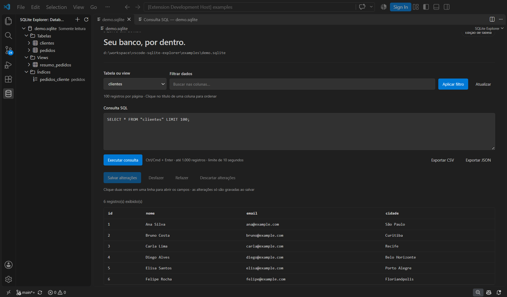
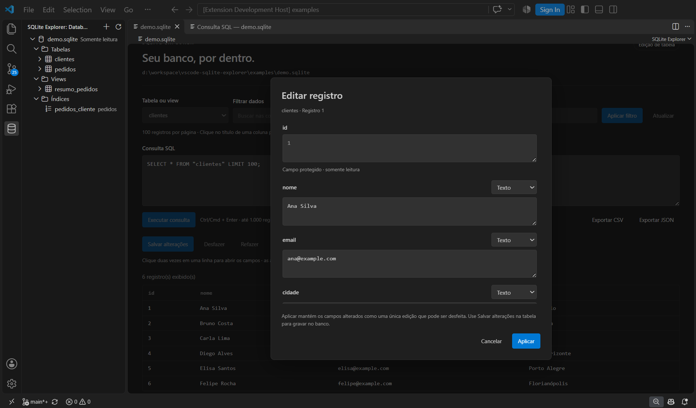
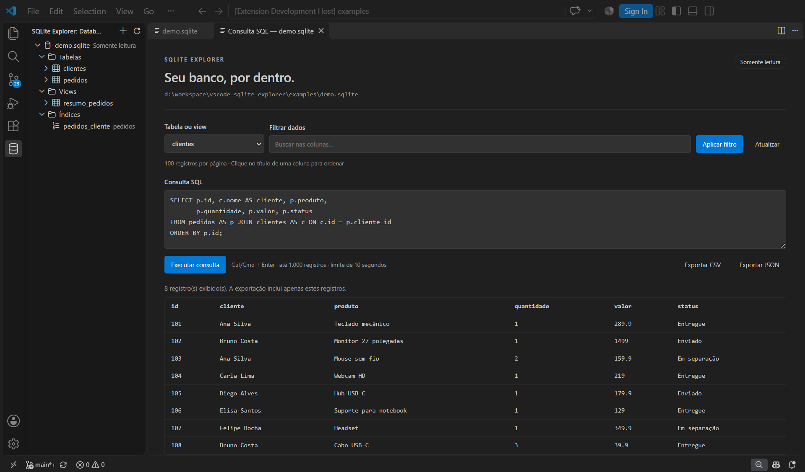

# LF SQLite Explorer

[Português](README.pt-BR.md) · [Changelog](CHANGELOG.md) · [Support](SUPPORT.md)

Browse SQLite databases, edit table cells, and run SQL queries inside Visual Studio Code. Supports **Windows x64** and **Linux x64 / WSL**, with English and Portuguese interfaces.

## Features

- Open `.db`, `.sqlite`, and `.sqlite3` directly in a database editor.
- Browse databases → Tables → table → columns in the file explorer or the SQLite activity-bar view. Views and indexes are listed too.
- Click a table to execute a paged SELECT: 100 rows per page, literal text filters, and column sorting.
- Right-click a database → **SQLite: SQL query** to open an independent query tab for JOINs, CTEs, subqueries, and aggregates.
- Double-click any row to open its fields vertically in a modal. Choose Text, Number, or NULL for editable fields; protected fields stay read-only.
- **Undo**, **Redo**, **Save changes**, and **Discard changes** for staged cell edits. VS Code Save and close prompts are integrated; hot-exit backups preserve drafts.
- Create a consistent SQLite backup before every write batch; save the batch in one transaction with foreign-key enforcement and row/schema conflict detection.
- Export the displayed rows to CSV or JSON. Pending edited values are included when they are visible in the grid.
- Remember database connections per workspace. Restoring the tree does not execute user SQL queries.

## Screenshots

Real captures from the VS Code Extension Development Host, using synthetic demonstration data.

### Database explorer and table



### Row editor opened by double-click



### SQL JOIN query



## Installation

Install [LF SQLite Explorer by lfcontato](https://marketplace.visualstudio.com/items?itemName=lfcontato.sqlite-explorer-local) from the Marketplace.

For a local package, run **Extensions: Install from VSIX…** and choose the package matching the machine where the extension runs:

| Environment | Package |
| --- | --- |
| Windows x64 | `sqlite-explorer-win32-x64.vsix` |
| Linux x64 or WSL | `sqlite-explorer-linux-x64.vsix` |

In WSL/SSH, install the Linux package on the remote extension host. The Windows package contains a different native binary. VS Code Web and virtual workspaces are not supported. VS Code **1.99+** and a trusted workspace are required.

## Using the explorer and SQL editor

1. Run **SQLite: Open database**, or open a SQLite file.
2. Expand its Tables folder and click a table to select its data.
3. Right-click a table → **SQLite: View table to the side** to use another editor column.
4. Right-click the database root → **SQLite: SQL query**, write a query, and press **Ctrl+Enter** / **Cmd+Enter**.

```sql
SELECT o.id, c.name
FROM orders AS o
JOIN customers AS c ON c.id = o.customer_id
LIMIT 100;
```

Adapt the table and column names to your database. The SQL editor is read-only; mutations are performed through the table grid's controlled save workflow.

## Editing, undo and redo

Double-click any grid row (or focus it and press Enter) to open a modal with all fields arranged vertically. Protected fields remain read-only; arbitrary query results can be inspected in a read-only modal. Choose the editable fields' types and use **Apply** or **Ctrl/Cmd+Enter**. Each applied row is one undoable command, even when several fields change. **Escape** or **Cancel** discards only the unapplied modal changes. Enter inserts a newline in a text field. Use the Undo/Redo buttons or **Ctrl/Cmd+Z**, **Ctrl/Cmd+Shift+Z**, or **Ctrl+Y** while the grid has focus. Inside an input, normal text undo applies.

Edits remain pending until Save, including any save triggered by your VS Code autosave configuration. Undo/Redo affect pending edits; **saving or discarding ends that history**. There is no automatic database rollback after a successful save. Save/discard before changing pages, tables, filters, or running another query.

Editable results must come from a real table with a declared, non-null primary key. Composite keys are supported. Key columns, generated columns, BLOB cells, views, arbitrary query results (including JOINs), and rows with unsafe JavaScript numbers are protected. Row insertion/deletion and arbitrary write SQL are not implemented.

A save creates `<database>.backup-<timestamp>-<random>.sqlite` next to the source using `VACUUM INTO`, which includes committed WAL data. It then opens a transaction, checks each original row fingerprint and table schema, applies the updates, reads back SQLite affinity/trigger results, and commits. A conflict or constraint error rolls back the complete batch and leaves the draft available. Backups are retained, including backups created before a failed save; manage their disk usage yourself. Save As is not supported for databases: use result export or the consistent backup.

## Settings and language

| Setting | Values / behavior |
| --- | --- |
| `sqliteExplorer.language` | `auto` (default), `en`, `pt`. Reload the window after changing. |
| `sqliteExplorer.openTablesBeside` | Open tables to the side by default. |

In `auto`, the tree and Webview follow the VS Code display language, falling back to English. Command/menu/settings titles use VS Code's native language packs independently of the Webview preference. Raw technical SQLite errors retain their original text.

## Architecture

TypeScript layers separate domain behavior, application use cases, SQLite adapters, and VS Code presentation:

```text
src/domain/          Database ports, stable errors, SQL policy, edit Command history
src/application/     Schema/paging service, connection factory/owner, result export
src/infrastructure/  Read-only query adapter, transactional write adapter, row fingerprints
src/explorer/        TreeDataProvider presentation
src/webview/         Validated messages and database editor controller
src/localization.ts  English and Portuguese catalogs
src/extension.ts     Composition root and CustomEditorProvider lifecycle
src/test/            SQLite integration, history, protocol and DOM tests
media/               Theme-aware Webview assets
```

Constructor/factory injection keeps the application independent of the driver. The write port is separate from the read-only SQL connection. The edit session uses the **Command pattern** for deterministic undo/redo. Statements, connections, and transactions have explicit ownership and cleanup. A CSP with nonce and DOM `textContent` protect the Webview; SQL identifiers are quoted and values are bound parameters.

The `sqlite3` N-API dependency is isolated in the infrastructure layer. Its upstream repository is archived, so a future migration can replace the adapters without changing the domain or UI. Dependency versions are recorded in the lockfile; a `minimatch` override fixes a transitive VSCE advisory.

## Limits

- Query results: 1,000 rows, 10-second interruption, 8 MiB serialized-result guard. Write batches: at most 100 rows and a 30-second interruption; lock timeout: 3 seconds.
- Pages use LIMIT/OFFSET; scans, sorting, and large offsets may be expensive. Navigation has no persistent snapshot across pages. Schema browsing supports up to 1,000 objects/columns.
- A native row must be read before the size guard runs. Project fewer columns for huge cells. BLOBs are displayed/exported as a hex preview of at most 128 bytes.
- Integers outside JavaScript's safe range can lose read precision; use `CAST(id AS TEXT)` in queries. Such rows are not editable. Use distinct aliases for duplicate query column names.
- CSV escapes quotes, separators, and line breaks and prefixes potential spreadsheet formulas with an apostrophe. JSON preserves the displayed scalar values.
- Save conflicts detect changes since the page was loaded, including BLOB changes; this is not a general-purpose transaction editor or collaborative merge system.

## Develop and package

Use Node.js **22.22+** and npm. The extension itself runs on VS Code's Node runtime.

```sh
npm ci
npm run check
npm test
npm audit
npm run package
```

Run `npm run demo` to create `examples/demo.sqlite` with synthetic customers and orders for screenshots. Existing files are left unchanged. The demonstration database and screenshots are excluded from runtime packages; screenshots remain available in the repository and READMEs.

Press **F5** to launch an Extension Development Host. Package native releases on their matching operating system:

```sh
# Windows x64 host
npx vsce package --target win32-x64 --out sqlite-explorer-win32-x64.vsix

# Linux x64 host
npx vsce package --target linux-x64 --out sqlite-explorer-linux-x64.vsix
```

Native dependency installation may require Python and C++ build tools if a prebuilt binary is unavailable. Automated tests cover real SQLite files, staging/history, atomic rollback, WAL-consistent backups, conflicts, protected cells, exports, protocol validation, localization, and the real Webview script in a DOM.

## Publishing

The publisher is `lfcontato`; the extension ID is `lfcontato.sqlite-explorer-local`. Build and test both target packages before publishing. In the [Marketplace publisher portal](https://marketplace.visualstudio.com/manage/publishers/lfcontato), choose **New extension → Visual Studio Code** and upload the target packages. Future automation should use [Trusted Publishing](https://code.visualstudio.com/api/working-with-extensions/publishing-extension#secure-automated-publishing-to-visual-studio-marketplace).

[Custom Editors API](https://code.visualstudio.com/api/extension-guides/custom-editors) · [Tree View API](https://code.visualstudio.com/api/extension-guides/tree-view) · [SQLite VACUUM INTO](https://www.sqlite.org/lang_vacuum.html#vacuum_with_an_into_clause)

MIT licensed. See [LICENSE](LICENSE).
